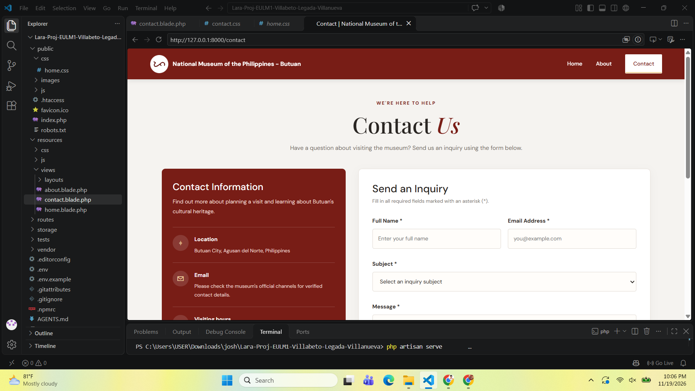

# Lara-Proj-EULM1-Villabeto-Legada-Villanueva

## Group Information
- **Section:** EULM1
- **Members:**
  - Villabeto (Member 1-HomePage, Group Leader)
  - Legada (Member 2-AboutPage)
  - Villanueva (Member 3-ContactPage)

## Theme
Our website is themed around the National Museum of the Philippines – Butuan, showcasing its exhibits, artifacts, and cultural heritage. It invites visitors to discover Butuan’s rich history through an elegant, museum-inspired design.

## Modules and Branches
| Member | Module | Branch |
|--------|--------|--------|
| Villabeto | Setup, Layout, Home Page | dev-member1-Villabeto |
| Legada | About Page | dev-member2-Legada |
| Villanueva | Contact Page | dev-member3-Villanueva |

## Screenshots

### Home Page


### About Page


### Contact Page


## Steps to Run the Project
```bash
git clone https://github.com/newdemeia/Lara-Proj-EULM1-Villabeto-Legada-Villanueva.git
cd Lara-Proj-EULM1-Villabeto-Legada-Villanueva
composer install
cp .env.example .env
php artisan key:generate
php artisan migrate
php artisan serve
```
Then open http://127.0.0.1:8000 in your browser.
