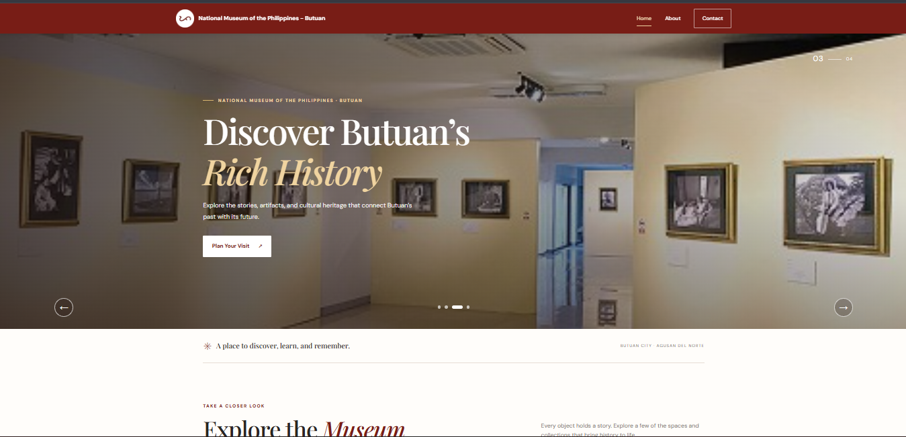
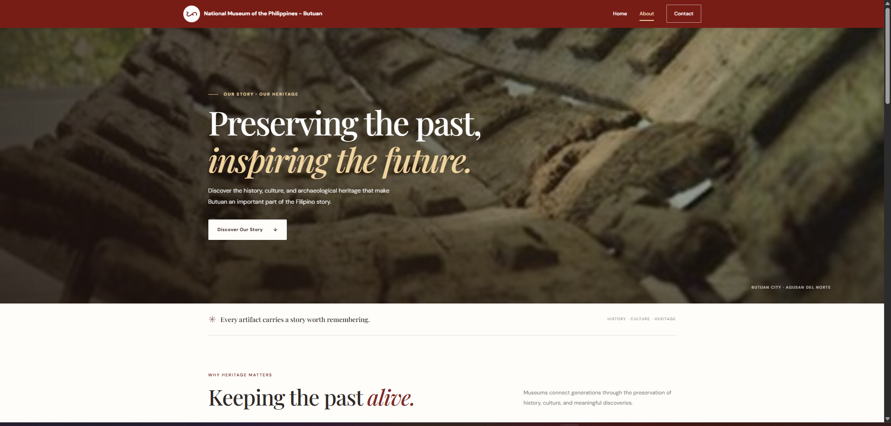

# Lara-Proj-EULM1-Villabeto-Legada-Villanueva

## Group Information
- **Group Name:** (your group name)
- **Section:** EULM1
- **Members:**
  - Villabeto (Member 1, Group Leader)
  - Legada (Member 2)
  - Villanueva (Member 3)

## Theme
Our website presents the National Museum of the Philippines – Butuan as a place to discover, learn, and remember. It highlights the museum's galleries, including Culture & Craft, Living History, Maritime Heritage, and Art & Memory. The design uses a maroon, cream, and gold palette to reflect the warmth and heritage of Butuan's past.

## Modules and Branches
| Member | Module | Branch |
|--------|--------|--------|
| Villabeto | Setup, Layout, Home Page | dev-member1-Villabeto |
| Legada | About Page | dev-member2-Legada |
| Villanueva | Contact Page | dev-member3-Villanueva |

## Screenshots

### Home Page


### About Page


### Contact Page


## Steps to Run the Project
```bash
git clone https://github.com/newdemeia/Lara-Proj-EULM1-LEGADA-VILLABETO-VILLANUEVA.git
cd Lara-Proj-EULM1-LEGADA-VILLABETO-VILLANUEVA
composer install
cp .env.example .env
php artisan key:generate
php artisan migrate
php artisan serve
```
Then open http://127.0.0.1:8000 in your browser.
